# AIUB Live

<p align="center">
  <a href="https://aiublive.vercel.app/">
    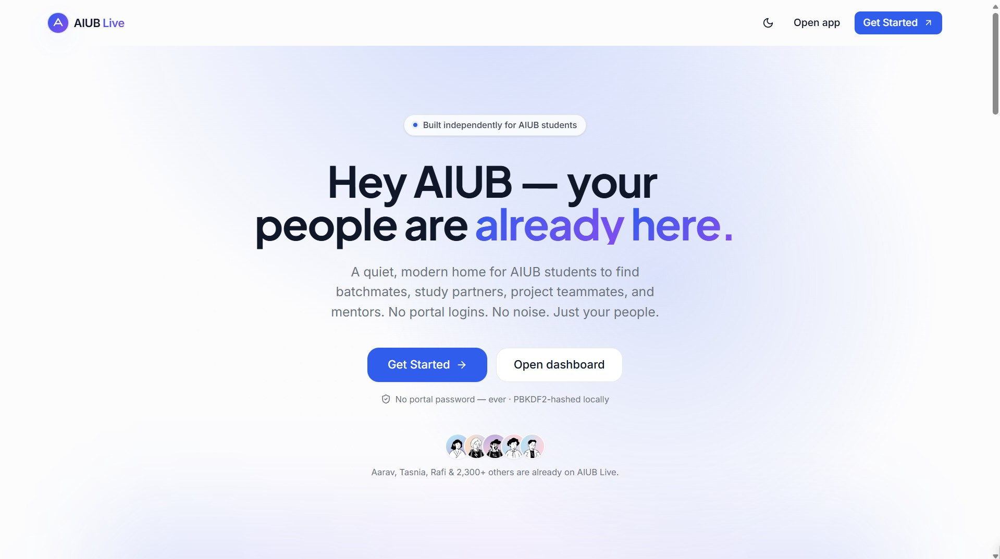
  </a>
</p>

<p align="center">
  <strong>AIUB Live</strong> is a premium campus identity and collaboration platform for AIUB students — focused on real profiles, meaningful discovery, and purposeful connection.
</p>

<p align="center">
  <a href="https://aiublive.vercel.app/">Live Demo</a> •
  <a href="https://mhtamim136.github.io/">Developer Portfolio</a>
</p>

<p align="center">
  
  
  
  
  
</p>

---

## Product introduction
AIUB Live is designed to feel like a modern SaaS product built specifically for the AIUB community. It replaces random social discovery with curated, identity-first connections — helping students find coursemates, project partners, and mentors without noise or distraction.

> **Live**: https://aiublive.vercel.app/

---

## Platform overview
AIUB Live focuses on **clean identity**, **intentional discovery**, and **high-quality UI/UX**. Every module is purpose-built for the AIUB ecosystem — departments, courses, and semester-specific collaboration flows.

**Core value pillars**
- **Student identity first**: rich profiles beyond grades
- **Calm discovery**: no infinite feed, no algorithmic noise
- **Purposeful collaboration**: project teams, mentors, and course-based connections
- **Privacy-aware**: masked IDs, no AIUB portal integration

---

## Feature highlights
- **Guided onboarding** with structured student profile creation
- **Smart discovery** with course, skill, and department filters
- **Daily connection picks** for focused networking
- **Coursemates finder** for shared classes
- **Project teams** marketplace with role matching
- **Mentor mode** for senior guidance
- **Connections + DMs** unlocked only after mutual acceptance
- **Calm campus pulse** (focused, non-noisy updates)

---

## Real-time features (roadmap ready)
AIUB Live is architected with real-time collaboration in mind. While the current demo runs fully client-side with mock data, the platform is designed for:
- Real-time connection requests and updates
- Live messaging and presence indicators
- Instant project team updates

---

## Authentication & security overview
- No AIUB portal credentials are used or stored
- Student ID format is validated and masked for privacy
- Current demo is entirely client-side for safe testing
- Ready to integrate real authentication (Clerk/Supabase/Auth0)

---

## Mobile responsiveness
The UI is built mobile-first and adapts cleanly across phones, tablets, and desktop. Core navigation, cards, and dashboards remain fully usable and visually balanced on small screens.

---

## Tech stack
- **Framework**: Next.js 14 (App Router)
- **Language**: TypeScript
- **Styling**: Tailwind CSS
- **State**: Zustand (persisted client state)
- **Animations**: Framer Motion
- **Icons**: Lucide
- **UI System**: component-driven design primitives

---

## Database architecture summary
The current version is a **frontend-first demo** with local state. The production-ready model is already shaped to support a real backend.

**Suggested production schema**
- **Users**: profile, department, semester, bio, skills
- **Courses**: course code, title, semester mapping
- **Connections**: mutual matches + DM access
- **Projects**: roles, skills required, team status
- **Messages**: thread + message metadata

---

## Performance optimizations
- Lightweight client state with persisted storage
- Reusable UI primitives to minimize layout shifts
- Fast navigation with Next.js App Router
- Optimized static assets for clean delivery

---

## Screenshots showcase
A curated look at the platform UI, structured for clarity and flow.

<table>
  <tr>
    <td align="center">
      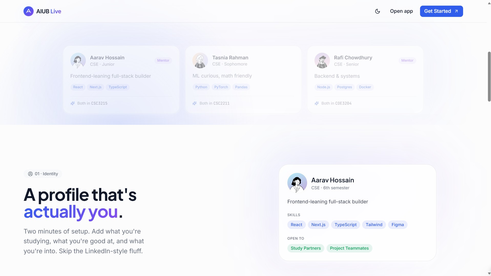
      <br /><sub><strong>Landing Experience</strong> — premium hero + product intro</sub>
    </td>
    <td align="center">
      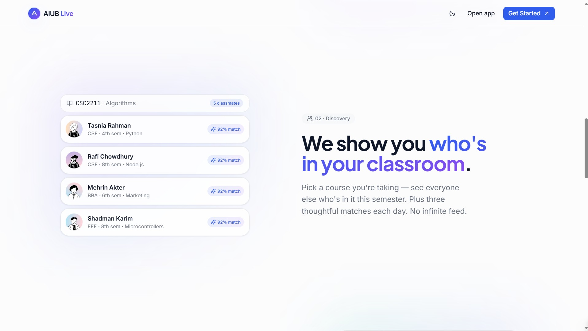
      <br /><sub><strong>Feature Preview</strong> — clear value propositions</sub>
    </td>
  </tr>
  <tr>
    <td align="center">
      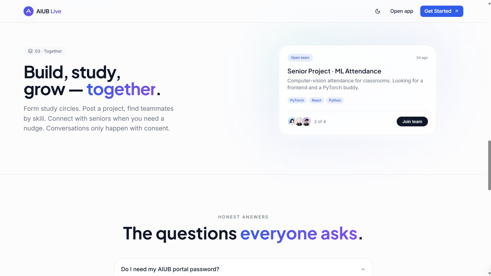
      <br /><sub><strong>Platform Vision</strong> — product storytelling</sub>
    </td>
    <td align="center">
      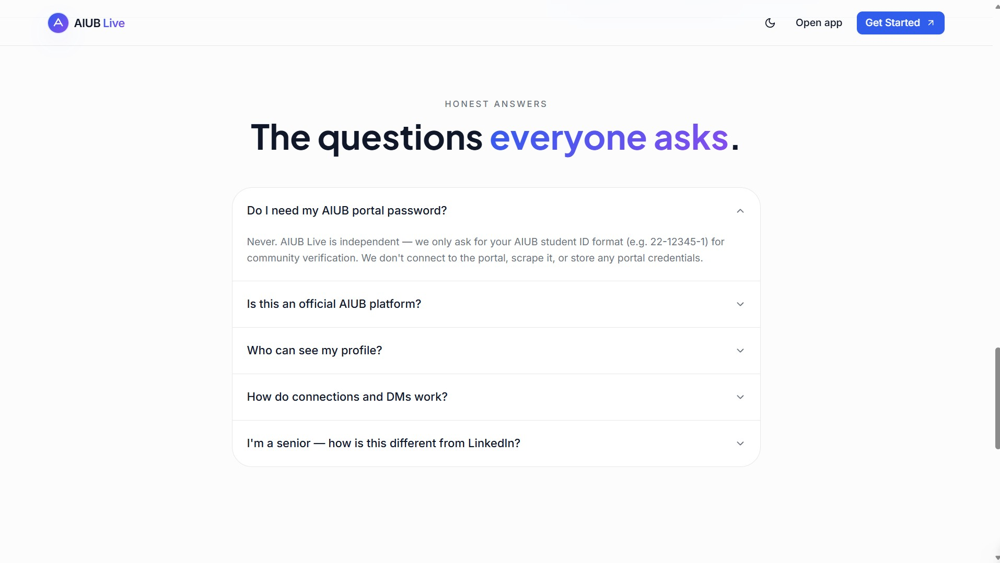
      <br /><sub><strong>Conversion Focus</strong> — CTA and onboarding preview</sub>
    </td>
  </tr>
</table>

---

## Key modules & pages
A quick view of the core application experience.

<table>
  <tr>
    <td align="center">
      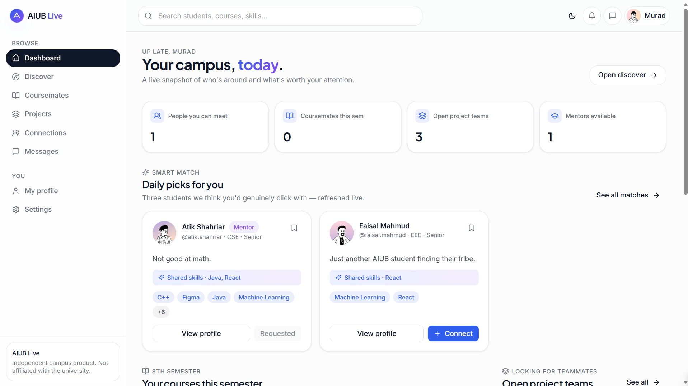
      <br /><sub><strong>Dashboard</strong> — daily smart picks and activity</sub>
    </td>
    <td align="center">
      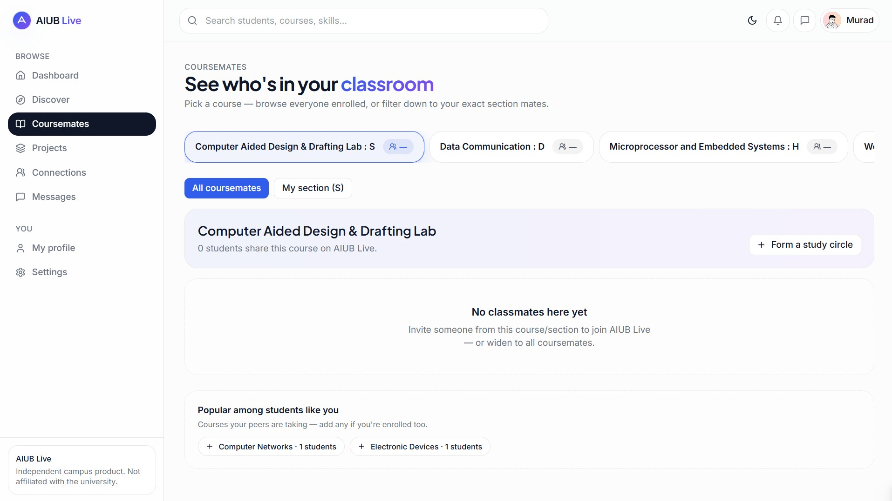
      <br /><sub><strong>Coursemates</strong> — class-based discovery</sub>
    </td>
  </tr>
  <tr>
    <td align="center">
      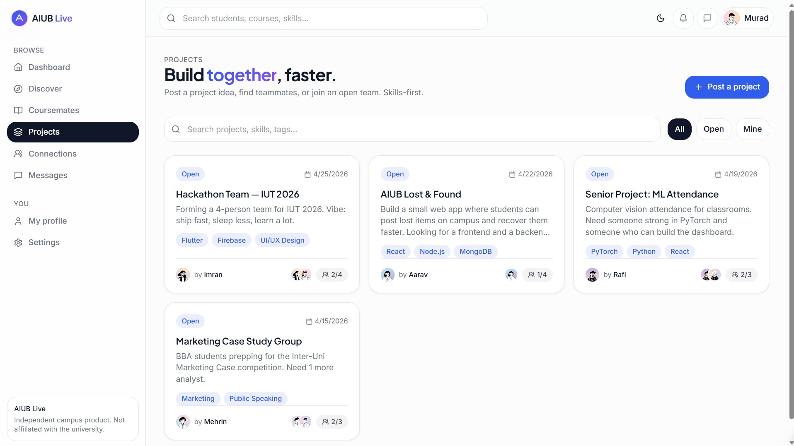
      <br /><sub><strong>Projects</strong> — team matching and collaboration</sub>
    </td>
    <td align="center">
      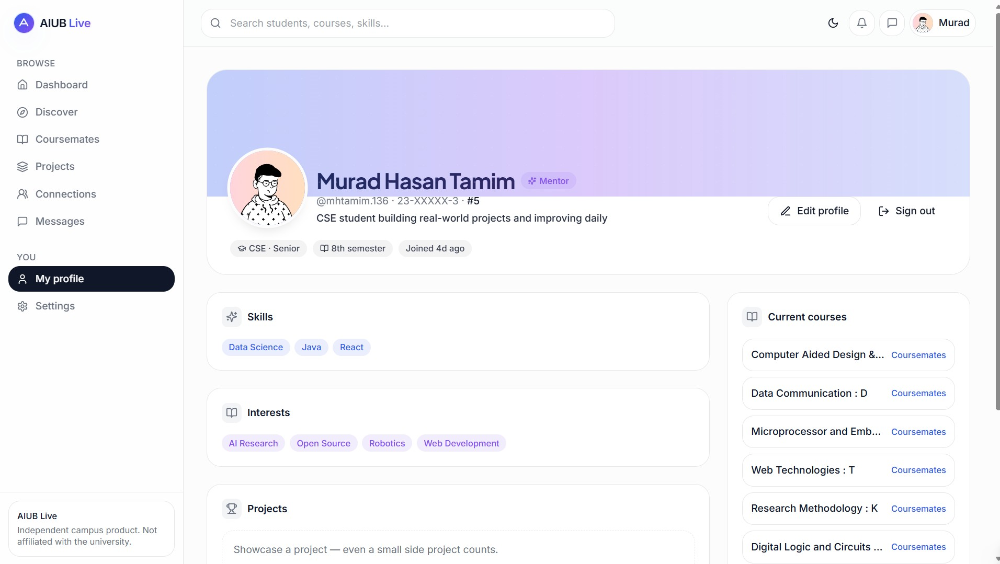
      <br /><sub><strong>Profile</strong> — identity-centric student view</sub>
    </td>
  </tr>
  <tr>
    <td align="center">
      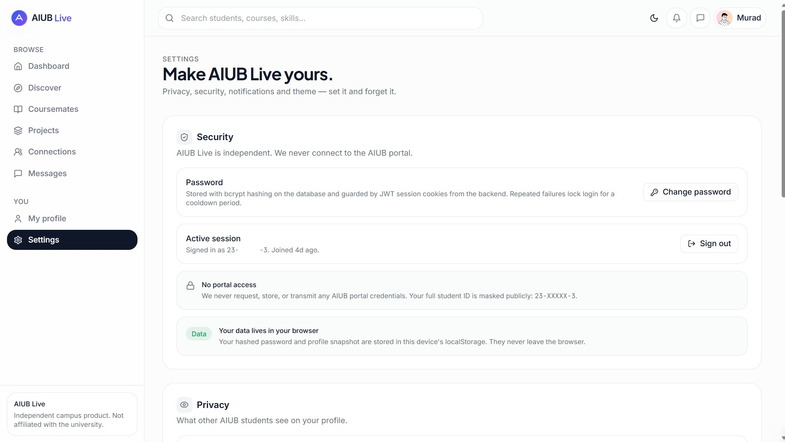
      <br /><sub><strong>Settings</strong> — control, privacy, and resets</sub>
    </td>
    <td align="center">
      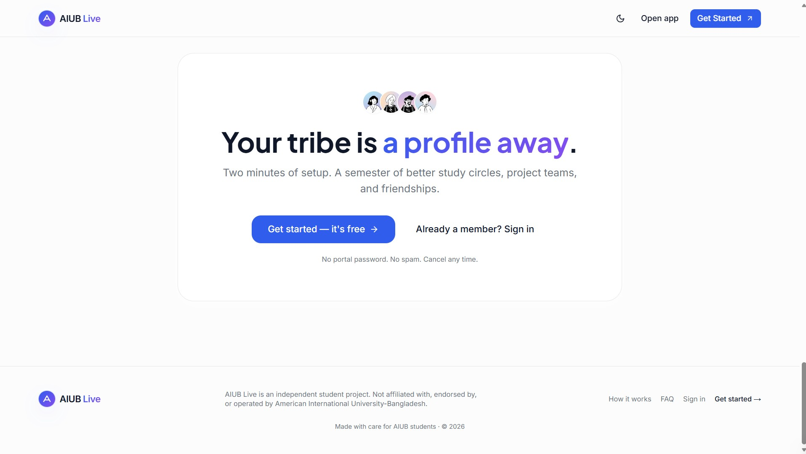
      <br /><sub><strong>Final CTA</strong> — clear call-to-action</sub>
    </td>
  </tr>
</table>

---

## Modern UI/UX highlights
- Minimal, clean surfaces with strong hierarchy
- Soft gradients and subtle motion for premium feel
- Consistent spacing system and card-based layout
- Dark-mode friendly typography and contrast

---

## Project structure overview
```
src/
  app/            → App router pages (marketing + platform)
  components/     → UI primitives + platform components
  lib/            → Domain types, matching logic, mock data
public/           → Static assets
```

---

## Deployment overview
- Hosted on **Vercel** for fast global delivery
- App Router architecture designed for scalable routing
- Ready for backend expansion without UI rework

---

## Future scalability direction
- Real authentication + student verification
- Backend integration (Postgres + Prisma)
- Real-time messaging and notifications
- Advanced search + matching algorithms
- Moderation and reporting tools for safety

---

## Why this platform is unique
AIUB Live is **not a generic campus feed**. It is a focused identity platform that respects student privacy while enabling real academic and project-based discovery — built specifically around AIUB’s structure and culture.

---

## Contributions

Contributions, ideas, and feature requests are welcome through Pull Requests, Issues, and Discussions.

Please discuss major changes before submitting a PR.

## License / usage restrictions
This is a **protected personal project**. Unauthorized copying, redistribution, commercial use, cloning, or reproduction of this project or its assets is prohibited. Legal action may be taken in response to unauthorized use.

---

## Developer
**Developed by Murad Hasan Tamim**  
Student of **American International University-Bangladesh (AIUB)**

---

## Contact / Portfolio
- Portfolio: https://mhtamim136.github.io/
- Live Platform: https://aiublive.vercel.app/

© 2026 Murad Hasan Tamim. All rights reserved.
